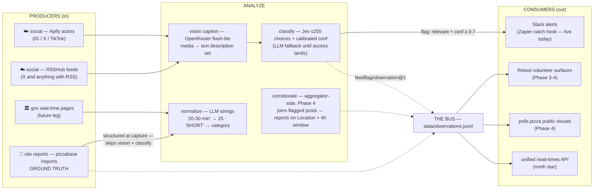

# feedflag

Social media feed reader + JEV relevance classifier. Reads posts from
Instagram / X / TikTok, builds **text description sets** with a cheap
OpenRouter vision model, hands them to **Jev** (TypeSafe AI — fast, typed
decisions with calibrated confidence), and pushes flagged posts to Slack
via a Zapier catch hook.

## Architecture

```
                    ingest (poll)                 caption (vision)            classify (text)           deliver
 ┌─────────────┐   ┌──────────────────┐   ┌───────────────────┐   ┌──────────────────┐   ┌─────────────────────┐
 │  Instagram   │   │ RSSHub / Apify   │   │  OpenRouter       │   │  Jev              │   │  Zapier             │
 │  X           ├──▶│ fetch + normalize├──▶│ vision model      ├──▶│ (System One Model)├──▶│  Catch Hook →       │
 │  TikTok      │   │ -> FeedItem[]    │   │ image+video→text  │   │ relevant? conf?   │   │  Slack channel msg  │
 └─────────────┘   └──────────────────┘   └───────────────────┘   └──────────────────┘   └─────────────────────┘
                        $0–$20/wk               <$1/wk                  pennies/wk        $0 (webhook) – $6/wk
```

Why the split: **Jev is text-only** (no images) — so the vision model
stands in for the media, producing a structured description set Jev scores
against. Jev picks a category from your enum and returns a *calibrated*
confidence; only `relevant && confidence >= FLAG_CONFIDENCE` gets delivered.
Everything JEV touches is string-in, typed-value-out (see
`JEV_EXPLORATION.md`): human-facing text is written by this codebase, not the
model.

## Cost options (the ask: < $350/wk — all options land 1–2 orders of magnitude under)

Assumed volume for the math: **~300 posts/day** across all sources, ~15%
flag rate. At PTP-ish volumes (30–60/day) everything is ~10x cheaper still.

### Per-leg comparison

| Leg | Option A — Zapier-heavy | **Option B — Apify + thin worker (recommended)** | Option C — RSSHub self-host |
|---|---|---|---|
| Ingest | Zapier triggers only cover *your own* accounts (mentions, your posts) — can't read arbitrary IG/TikTok feeds; needs A *or* C upstream anyway, then charges tasks on top | Apify managed scrapers, pay-per-result. IG scraper ~ $0.002–0.008/post → **$5–20/wk** at 300/day | RSSHub on an always-on box → **$0**, but IG/X/TikTok routes are flaky (tokens, cookies, proxies) — budget engineering time, expect breakage |
| Caption | AI-by-Zapier steps don't do vision well; Code steps (paid plan only) → awkward | OpenRouter `gemini-2.5-flash-lite` ≈ $0.10/MTok in / $0.40 out. ~2100 posts × ~1.3k tok ≈ **<$1/wk**. `llama-3.2-11b-vision:free` → **$0** if rate limits suffice | same as B |
| Classify | — | Jev: $0.042/MTok in, **output free** → ~1.5 MTok/wk ≈ **$0.06/wk**. Until waitlist lands: flash-lite fallback ≈ <$1/wk (uncalibrated confidence) | same as B |
| Deliver | every post through multi-step Zaps ≈ 3–4 tasks × 300/day ≈ **$25–40/wk** in plan tiers, AI steps extra | **flagged posts only**: ~15/day × 2–3 tasks ≈ 1.1k tasks/mo → cheapest paid plan ≈ **$5/wk**; or skip Zapier → Slack webhook **$0** | same as B |
| Worker | inside Zapier | GH Actions schedule (free minutes) or launchd → **$0** | RSSHub host + worker → **$0** |
| **Total / wk** | **$25–50+** and rigid (JSON-heavy work in Zapier is painful) | **≈ $6–27** ✅ | **≈ $2–10**, fragile |

### Other ingestion vendors (considered)

- **X API official**: $200/mo Basic tier with read caps far below our volume — not worth it.
- **Instagram/Facebook Graph API**: own-account + hashtag limits only; Research-style access is gated.
- **TikTok official APIs**: content posting only; Research API is academic-gated.
- **Bright Data / PhantomBuster scraping APIs**: most reliable, $300+/mo at this volume (≈ $75/wk) — plausible fallback if Apify routes degrade, still under budget.

### Recommendation

**Option B.** Zapier stays *only in the delivery leg* (one Catch Hook Zap →
Slack) where its task pricing only sees flagged posts — routing/channel/digest
logic stays in Zapier where it's cheap to change. Anything volume-weighted
(ingest, caption, classify) runs in this repo on schedule. Weekly cost ≈
**$6–27**, i.e. ~10–50x under the $350/wk ceiling, with ~10x headroom before
the budget is even approached.

## Quickstart

```bash
git init . && cp .env.example .env          # fill keys (OPENROUTER_API_KEY=$OPENROUTER_KEY_PERSONAL)
cp config/feeds.example.json config/feeds.json  # edit sources + categories
npm i
npm start -- --dry-run --limit 5            # ingest+caption+classify, no delivery
npm start                                   # full run
```

Flags: `--dry-run` (no notify/state), `--no-notify`, `--limit N`,
`--source <substring>` (e.g. `--source instagram`, `--source tiktok/@foo`).

State lives in `data/` (`seen.json` dedupe + `flagged.jsonl` audit log +
`observations.jsonl` normalized output) —
never re-caption the same post twice. If you run on ephemeral CI, the included
GitHub Actions workflow commits state back at the end of each run (or run via
launchd on an always-on Mac and skip that).

## The Zapier leg (one Zap, ~10 min setup)

1. In Zapier: create Zap → Trigger **Webhooks by Zapier → Catch Hook**, copy
   the webhook URL into `.env` as `ZAPIER_CATCH_URL`.
2. (Optional) Filter step: only continue when `category` ≠ `irrelevant` —
   belt-and-suspenders with the in-code `FLAG_CONFIDENCE` gate.
3. Action: **Slack → Send Channel Message**, map `text` from the catch-hook
   payload (ready-made Slack-formatted), or compose from fields — the payload
   includes `category`, `confidence`, `author`, `platform`, `url`,
   `image_descriptions`, plus `media_urls` / `media_embed` (first embeddable
   image URL — ready for a Slack image block in a Zapier step).
4. Publish the Zap. Test with `npm start -- --limit 3`.

To route different categories to different channels or add a digest, add Zap
paths/filters — no code changes here. Delivery via the included Slack-webhook
notifier (`SLACK_WEBHOOK_URL`) is the $0 alternative if you drop Zapier.

## JEV notes

- Waitlist requested **2026-12-04**; until it lands the pipeline runs on the
  flash-lite fallback (`src/classify/llm-fallback.ts`) — same interface,
  uncalibrated confidence, so keep `FLAG_CONFIDENCE` lower and eyeball
  `data/flagged.jsonl`.
- `src/classify/jev.ts` is written against the published mental model
  ("typed decisions, calibrated confidence, ≤255 choices, output free") and
  **will need its transport rewritten** on first contact with the real API.
  Everything else depends only on the `DecisionProvider` interface — that's
  deliberate, per the swappable-interface plan in `JEV_EXPLORATION.md`.
- Categories come from `config/feeds.json` (≤255). Jev never writes strings —
  all human-facing text lives in `src/notify/format.ts`.

## Producer / consumer architecture



All four legs emit the same `feedflag/observation@1` record into
`data/observations.jsonl` — the bus. The aggregator (pizzabase) joins on
Location + time window and produces the outward feeds.

**The asymmetry that matters: site reports are ground truth, not just another feed.**
They're structured at capture (validated address -> geocoded `Location`) and
volunteer-reviewed, so the crowd leg (`src/ingest/reports.ts`) skips the
vision captioner and the Jev classify step entirely — direct observations at
`confidence: 0.95` with `location` attached. Social/govt extractions are
*predictions*; user reports are *observations*.

- **Corroboration** (aggregator-side, `REPORT_DECAY` = 4h window): a Jev-flagged
  social post at Location L within a few hours of a matching user report
  raises effective confidence; disagreement routes to volunteer review.
  pizzabase already pushes new reports to Zapier (`zapNewReport`) — same event
  stream, different consumer.
- **Free-text waitTime**: `Report.waitTime` is a string, normalized by the
  shared `src/normalize/wait-time.ts` prompt ("20-30 min" -> 25, "15 people in
  line" -> ~15) — the same normalizer the future govt extraction leg uses.
- **Location matching**: crowd reports come with `location` fields filled;
  social/govt legs need retrieve-then-match (geocode -> <=255 candidates ->
  Jev picks) — see Jev notes below.

## Future scope: nationwide polling-place status aggregator

feedflag is built to join `GOVT_WAIT_TIME_SOURCES_PLAN.md` (Phases 2–4:
discovery → extraction → unified wait-time API) without rework — both
pipelines share the same shape: **fetch → describe/extract → classify → route**.

**What stays the same**
- Apify stays the social-ingest answer; adapters stay per-domain (Apify
  actors for social, polite plain-HTTP crawling for gov pages — the plan's
  rate-limiting rules apply to that leg, not this repo).
- **One decision layer across both legs.** The same `DecisionProvider` (Jev,
  or the fallback) classifies "is this a poll-line report?" from social
  description sets and "does this county page contain wait-time data?"
  (Phase 2 discovery). Jev's calibrated confidence drops straight into the
  existing `discovery_confidence` column.

**What changes (already scaffolded)**
- feedflag's primary output is a **normalized observation stream** —
  `data/observations.jsonl`, `feedflag/observation@1` records shaped to load
  into `wait_time_readings` (`source_type='social'`, `confidence`, `raw_json`
  pattern). Slack/Zapier is one consumer (alerting), not the sink. Social
  posts become a third observer class — scraped gov pages, user-submitted
  reports, classified social posts — corroborating each other.
- Flagged posts mentioning wait-time pages can seed Phase 2 discovery
  candidates (`discovery_method='social_v1'`) — a discovery flywheel.

**Division of labor stays** (JEV_EXPLORATION.md): LLMs are the string
  generators/extractors ("20-30 min" → `wait_minutes: 25`, precinct names);
  Jev stays at the fuzzy decision points (classify, route, gate,
  high-confidence auto-accept). Jev cannot generate strings.

**Design watch-item for the join:** location matching must be
  *retrieve-then-match* — geocode/normalize → candidate set ≤ 255 → Jev picks
  with calibrated confidence. A nationwide candidate set blows past Jev's
  255-choice cardinality; match per-county/per-state.

**Budget with both legs:** social ≈ $6–27/wk (above) + govt leg ≈
  single-digit $ per nationwide discovery scan on Jev (vs ~$100 frontier-LLM
  scan budgeted in the plan) + ~$1/day extraction on flash-lite, spiking only
  election-day per the plan's ~$200–500/cycle. Combined ≈ **$15–40/wk** —
  still >10x under the $350/wk envelope, with Jev amortized across both
  pipelines. The aggregator itself (matching, API, Retool surfaces) lives in
  pizzabase; feedflag just emits loader-compatible JSONL.

## Feedback loop (correcting the classifier)

Flags carry a stable 8-char **ID** everywhere they surface (Slack digests,
findings comments, review queue) — `sha256(domain:source_ref:observed_at)`.

**First feedback cycle landed (2026-10-18):** 4/4 flags labeled 👎 (dog photo,
press appearance, "It's done! #Vote", ballot-integrity press release) →
precision 0% at every threshold. Fixes shipped: `flagCategories` policy
(`config/feeds.json` — only line-related categories raise Slack flags;
press/community/delivery are archive-only) and **wrong-labeled flags are
excluded from every digest** — once you 👎 something, you never see it again.

Three ways to give feedback, ranked by friction:

1. **Tell Pi in chat** — "the `cbe91f81` flag was wrong" (or "@badrobot68 wasn't a
   poll line") — it applies the label with the script.
2. **The CLI**:
   ```bash
   npm run label -- --list                 # review queue (unlabeled flags, last 25h)
   npm run label -- --add cbe91f81=wrong:press_mention,f79ae22f=right
   npm run label -- --report               # precision @ thresholds, calibration, confusion pairs
   ```
   Labels land in `data/labels.jsonl` — commit them as regular work.
3. **Slack reactions** (planned — needs a bot token): 👍/👎 on flag posts,
   collected by a scheduled step. Ticket: see issue tracker.

**What labels do** (honest version — Jev isn't user-retrainable):
- **Tune `FLAG_CONFIDENCE`** against measured precision (`--report` suggests the
  smallest threshold hitting ≥90% precision)
- **Measure Jev calibration** — stated confidence vs actual accuracy per bucket,
  the `JEV_EXPLORATION.md` §3 gate. If Jev says 90% and is right 70%, the
  threshold compensates or the miscalibration goes upstream to TypeSafe.
- **Confusion pairs** (`picked → should have been`) expose taxonomy problems —
  categories are just `config/feeds.json`; merge/split there.
- **Few-shot the LLM fallback** — misclassified examples can be inlined into
  the fallback prompt (not yet wired; labels.jsonl is the corpus).

Ground-truth crowd rows (`domain:"crowd"`) are excluded from flags/queue/report —
there's no classifier pick to correct.

## Verifying the tracked sources (human-checkable links)

Every tracked county source, with the public page a person can open and eyeball:

| # | County | What we track | Verify it yourself |
|---|--------|---------------|--------------------|
| 1 | TX Tarrant | wait-times page + GIS app | [county wait-times page](https://www.tarrantcountytx.gov/en/elections/current-election-information/wait-times.html) · [GIS lookup](https://gisit.tarrantcounty.com/tcvotingwaittime/) |
| 2 | TX Travis | current-election page (wait-time maps) | [votetravis.gov](https://votetravis.gov/current-election-information/current-election/) |
| 3 | TX Dallas | ArcGIS Experience (map-interact TBD) | [Experience map](https://experience.arcgis.com/experience/2fe81f8ed7a1474fb75777b5a99e586a/page/Main-Page) |
| 4 | NC Guilford | wait-time dashboard (REST) | [county early-voting page](https://www.guilfordcountync.gov/government/board-elections/early-voting) · [dashboard](https://www.arcgis.com/apps/dashboards/366db50595a64452a55052bc08eee5d7) · [raw data table](https://services5.arcgis.com/RR1v7NWFfwk98pUn/arcgis/rest/services/Early_Voting_Locations/FeatureServer/0/query?where=1%3D1&outFields=Station,Address,Wait&returnGeometry=false&f=html) |
| 5 | NC Wake | Airtable wait-time tracker | [wakevotesearly.com](https://www.wakevotesearly.com) · [Airtable tracker](https://airtable.com/appAL6KsUEvshj4br/shrQkIIFla4bjdGzh) |
| 6 | TX Harris | official WaitTimes app (its own JSON API) | [harrisvotes app](https://app.harrisvotes.com/WaitTimes?lang=en-US) — search an address, popup shows the estimated wait |
| 7 | TX Bexar | Election Wait Times app | [maps.bexar.org](https://maps.bexar.org/ElectionWaitTimes/) |
| 8 | TX El Paso | per-site "Current Wait Time" (server-rendered) | [early-voting locations](https://epcountyvotestx.gov/voter-information/early-voting-locations) |
| 9 | NC Durham | locator + wait-times | [dcovotes locator](https://www.dcovotes.dconc.gov/voters/voting/early-voting) |
| 10 | NV Clark | locator webmap + public Experience (REST: `VoteCenterWaitTimes/2`) | [locator](https://elections.clarkcountynv.gov/VoteCentersVoter/index.html) · [public Experience](https://experience.arcgis.com/experience/4a7186f2cc5e41469037f7b1601790cf/) · [raw data table](https://maps.clarkcountynv.gov/arcgis/rest/services/Elections/VoteCenterWaitTimes/FeatureServer/2/query?where=Election_Code%3D%2726GE%27&outFields=SITE_NAME,WAIT_TIME,Last_Refresh&returnGeometry=false&f=html) |
| 11 | FL Miami-Dade | wait-times page | [votemiamidade](https://www.votemiamidade.gov/elections/voters/early-voting-wait-times.page) |
| 12 | GA Fulton | dashboard (REST) | [dashboard](https://www.arcgis.com/apps/dashboards/1a86b03b27fa48188bf3699c4eccfb20) · [raw data table](https://services1.arcgis.com/AQDHTHDrZzfsFsB5/arcgis/rest/services/Fulton_EarlyVoting_2026/FeatureServer/0/query?where=1%3D1&outFields=precinct_location_name,wait_current&returnGeometry=false&f=html) |

The `f=html` "raw data table" links are the exact FeatureServer queries the extractor runs,
rendered as a plain table in any browser — no GIS, no clicks.

**Verification lesson (2026-10-21):** Clark's numbers were caught wrong by eyeballing the
county's public Experience against our Slack posts — we were reading
`PollingPlaces/FeatureServer/0` (stale/test numbers: 80-106 min) while the public apps read
`Elections/VoteCenterWaitTimes/2` ("Voting Centers_Prod" webmap, Election_Code `26GE`,
fresh `Last_Refresh` stamps). Config fixed; the county's public app is always ground truth
for which service to read.

## Two-tier feeds: vetting → graduated (vol-facing)

Low report volume means human vetting carries the calibration load. Two channels:

| | **Vetting channel** (`SLACK_WEBHOOK_URL`) | **Volunteer channel** (`SLACK_VOLS_WEBHOOK_URL`) |
|---|---|---|
| Audience | PTP staff, pre-election | Volunteers, election week |
| Govt readings | changed readings ≥ **15 min** (🧪 unverified sources included — churn is the point: you smell-test the source) | changed readings ≥ **60 min** from **graduated sources only** (✅ verified vs the county's public page) |
| Social flags | current `FLAG_CONFIDENCE` | **none yet** — measured precision is 0% (labels corpus); social graduates only when `npm run label -- --report` earns it |

- **Graduation is a human decision**, recorded as `graduated: true` on the source in
  `config/govt-sources.jsonl` (mirrors `wait_time_sources.is_active`/`last_verified_at`
  in the pizzabase schema — the DB anticipated this).
- Graduated so far (verified 2026-10-21): **Clark NV, Guilford NC, Wake NC, Harris TX, El Paso TX**.
  Ungraduated on purpose: Tarrant GIS + Miami-Dade (vision-extracted, not yet eyeballed vs public page).
- `SLACK_VOLS_WEBHOOK_URL` unset → single-channel mode (vol-eligible lines post to the vetting channel).
- Honest timeline: graduation decisions locked **before Nov 1** (DST bump day); the election-day
  hot mode sweeps both channels every 15 min.

## Caveats

- Scraping IG/TikTok is against platform ToS; Apify/RSSHub routes degrade
  periodically. Every ingest failure is logged per-source and doesn't sink
  the run — watch the flags output for gaps.
- `normalizeApifyRecord` field names vary by actor version; run `--dry-run`
  against real data and adjust picks.
- OpenRouter keys already exist in `~/.zshrc` (`OPENROUTER_KEY_PERSONAL`) —
  set a spend cap on the key in OpenRouter settings as a hard stop, this repo
  also caps `MAX_POSTS_PER_RUN`.

## Layout

```
src/
  index.ts          CLI entry
  pipeline.ts       ingest → describe → classify → flag → emit + notify
  config.ts         env + feeds.json
  types.ts          FeedItem / DescriptionSet / DecisionProvider / Notifier
  ingest/rsshub.ts  RSS/Atom via RSSHub routes (IG/X/TikTok)
  ingest/apify.ts   Apify actor runs + per-platform normalizers
  describe/openrouter.ts  vision captioner (images + ffmpeg video frame)
  classify/jev.ts   JEV client (transport TBD pending waitlist)
  classify/llm-fallback.ts fallback classifier (until waitlist lands)
  emit/records.ts   normalized Observation records (aggregator-ready, see below)
  notify/           Zapier catch hook + Slack webhook + message formatting
  store/jsonl.ts    seen.json dedupe + flagged.jsonl + observations.jsonl
.github/workflows/feedflag.yml  every-30-min schedule (with state commit-back)
```