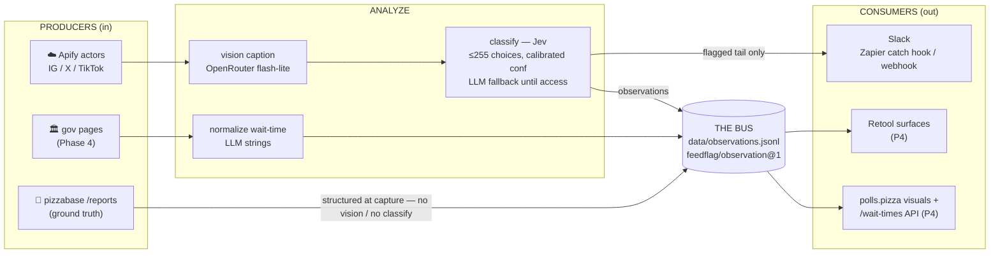

# feedflag — Technical Design

> Status: **Draft for review** | Created: 2026-10-17 | Epic: FEAT-002 (Stages 1–2)
> Related: `README.md` (architecture), `~/Projects/JEV_EXPLORATION.md`, `~/Projects/GOVT_WAIT_TIME_SOURCES_PLAN.md`

## 1. Context & goal

Pizza to the Polls needs visibility into what's being said *and shown* across social
platforms (Instagram, X, TikTok) — poll-line reports, delivery moments, press mentions —
without a human doom-scrolling four feeds. Longer term (future scope), the same normalized
stream feeds a **nationwide polling-place status aggregator** that joins social signals,
government wait-time pages, and site-submitted ground-truth reports.

feedflag is that pipeline: **heterogeneous producers → one normalized observation bus →
many consumers**, with model analysis (vision captioning, JEV classification) applied only
where the producer isn't already structured.

## 2. Goals / non-goals

**Goals**
1. Social feeds (IG/X/TikTok) → classified flags in Slack, asynchronously, ≤ $350/wk ceiling
   (actual: $6–27/wk social)
2. One schema (`feedflag/observation@1`) shared by every leg — social, crowd, future govt
3. JEV as the decision layer *when access lands*; cheap LLM fallback until then — swappable,
   never a hard dependency
4. Site reports as **ground truth** — corroborate model predictions, calibrate JEV confidence

**Non-goals (per phase gate)**
- No JEV transport commitment before TypeSafe waitlist lands (Phase 3 rewrite expected)
- No govt-page crawling / extraction in this epic (Phase 4; wait-time plan Phases 2–3)
- No public API / visuals surfaces here (Phase 4; aggregator lives in pizzabase)
- No string generation from JEV — human-facing text stays in code (`notify/format.ts`)

## 3. Architecture (recap — details in README)

Division of labor (load-bearing, from JEV_EXPLORATION): **LLMs generate strings**
(captions, wait-time normalization); **Jev makes typed decisions** (category pick +
calibrated confidence). Crowd reports skip both — structured at capture, `confidence: 0.95`.

## 4. Build phases

| Phase | Scope | Status | Depends on | Est. cost |
|---|---|---|---|---|
| **0** | Provision accounts & keys | **this epic** (ticket FEAT-002a) | — | ~$0–20/mo runtime |
| **1** | Social leg live E2E | **this epic** (FEAT-002b) | P0 | ~$5–20/wk |
| **2** | Crowd leg + observation bus + Zapier delivery | **this epic** (FEAT-002c) | P0, P1 | ~+$1/wk |
| **3** | JEV integration + calibration gate | future | waitlist access | ~$0.06/wk on Jev |
| **4** | Govt leg + aggregator + public surfaces | future | P2, P3 | $15–40/wk combined |

### Phase 0 — Provision (FEAT-002a)
Human work, no code. Accounts: Apify (+token, pay-per-result), OpenRouter (reuse
`OPENROUTER_KEY_PERSONAL` + set spend cap), Slack incoming webhook, Zapier (catch-hook Zap),
TypeSafe JEV waitlist, pizzabase machine token (Phase 2), GitHub repo secrets for Actions.
**Done:** every key in `.env` verified by a `--dry-run` ingest.

### Phase 1 — Social leg live (FEAT-002b)
Turn the scaffold into a running pipeline: real Apify actor runs, fix
`normalizeApifyRecord` field picks against live datasets, live captioning,
LLM-fallback classify, Slack webhook delivery, GH Actions schedule with state
commit-back. **Done:** flags from real IG/X/TikTok posts arrive in Slack; cost
telemetry (tokens/run) recorded; `FLAG_CONFIDENCE` tuned on false positives.

### Phase 2 — Crowd leg + bus + Zapier (FEAT-002c)
Wire `src/ingest/reports.ts` against the real pizzabase reports API (machine token),
wait-time normalizer live, both legs appending `observations.jsonl`, replace raw
webhook with Zapier catch-hook consumer (routing/filtering in Zapier).
**Done:** social + crowd observations in one JSONL, in-pipeline dedupe verified
(no re-captioned posts), Slack delivery via Zapier with per-category routing.

### Phase 3 — JEV integration (future)
Rewrite `classify/jev.ts` transport against the real TypeSafe API; backfill
labeled pairs (flagged posts vs. corroborating reports); run the calibration gate
from JEV_EXPLORATION §3 (accuracy, calibration, ≥10x cost cut — any two of three).
**Done:** Jev live behind `resolveClassifier()`, fallback retained as emergency.

### Phase 4 — Govt leg + aggregator (future)
Wait-time source discovery/extraction (GOVT_WAIT_TIME_SOURCES_PLAN Phases 2–3),
retrieve-then-match location resolution (≤255 candidates per Jev pick), corroboration
joins on Location + `REPORT_DECAY` window, `/wait-times` API + Retool + polls.pizza.
**Done:** unified API serving corroborated wait-times; feedflag emits loader-compatible
JSONL only — aggregator logic lives in pizzabase.

## 5. Key decisions

| # | Decision | Rationale |
|---|---|---|
| D1 | **Apify** for social ingest | pay-per-result ($0.002–8/post), official MCP server for interactive runs; Zapier can't read 3rd-party feeds; RSSHub flaky on IG/X |
| D2 | **Zapier only in the delivery leg** | task pricing sees only flagged tail (~15/day) — $0–5/wk; routing stays editable outside code |
| D3 | **The bus is JSONL files** | no queue infra; append-only, replayable, loader-ready for `wait_time_readings` |
| D4 | **Crowd = ground truth** | reports structured at capture + volunteer-reviewed; corroborate predictions, calibrate Jev |
| D5 | **Jev swappable** | pre-track-record vendor; `DecisionProvider` seam + LLM fallback, never hard-dependent |
| D6 | **PII floor** | `contactInfo` never emitted from reports leg; only `reportURL` + Location fields |
| D7 | **One DB: pizzabase's Postgres** (2026-10-18) | feedflag gets no separate tracker DB — observations land in pizzabase via machine-token HTTPS bulk-load (`feed_observations`); the Phase-4 corroboration joins stay in-database; JSONL remains the audit log / dry-run buffer. RDS/Aurora-for-feedflag rejected: VPC friction + cross-DB federation for zero benefit |

## 6. Risks

- **Scraper decay** — Apify routes degrade periodically; mitigated by per-source
  isolation (`Promise.allSettled`), never a hard fail. Budget Bright Data (~$300+/mo) as fallback.
- **Uncalibrated confidence pre-Jev** — fallback confidence is rough; `FLAG_CONFIDENCE`
  starts conservative (0.7), human reviews `flagged.jsonl` until Phase 3 gate.
- **Location matching** (P4) — nationwide candidate sets blow past Jev's 255-choice
  limit; must be retrieve-then-match per-county/state.
- **ToS** — scraping IG/TikTok is against platform ToS; keep volumes tiny, UA identified.

## 7. Review checklist

- [ ] Phase boundaries & acceptance criteria agree with intent
- [ ] D1–D6 decisions ratified (esp. D2 Zapier-in-delivery-only, D3 file bus)
- [ ] Cost envelope accepted ($6–27/wk now, $15–40/wk combined P4)
- [ ] Epic child tickets (FEAT-002a/b/c) scoped for pickup